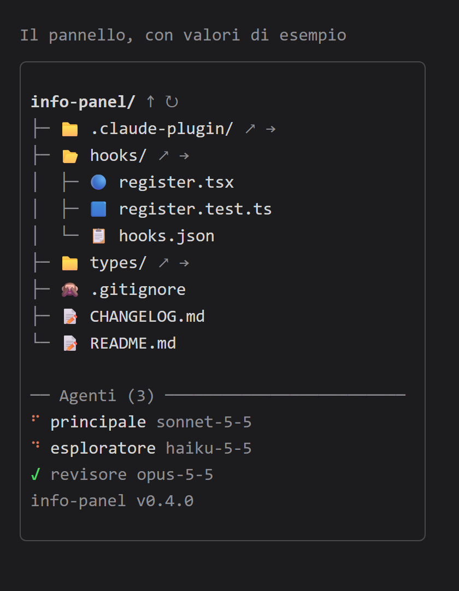

# info-panel

Mod per Claude Code che apre un pannello a lato del transcript, diviso in due sezioni:



L'immagine è un'illustrazione con valori di esempio.

- **In alto (circa 80%)**: l'albero della cartella di lavoro, con le guide `├─`, `└─` e `│` che mostrano
  l'indentazione e un'icona per tipo di file (cartelle gialle, file per famiglia: PHP, JavaScript,
  TypeScript, JSON, Markdown, immagini, archivi e così via).
  Le cartelle vengono prima dei file, tutto in ordine alfabetico; `.git` e `node_modules` non compaiono.
  La rotella del mouse sopra l'albero lo scorre.
  - Nell'intestazione, accanto al nome della cartella di lavoro, due pulsanti: `↑` sposta la cartella di lavoro
    della sessione sulla cartella padre (alla radice di un'unità non fa nulla e lo segnala), `↻` rilegge le
    cartelle aperte, che si riallineano da sole anche a fine turno.
  - Un clic sul nome di una cartella la apre o la chiude. Dopo il nome ogni cartella ha due pulsanti:
    `↗` apre Esplora risorse su quella cartella (solo Windows; compare un avviso di conferma e, se non riesce, uno con il motivo),
    `→` ne fa la cartella di lavoro della sessione. Il doppio clic non esiste più.
  - Un clic su un file inserisce `@percorso` nel prompt, alla posizione del cursore.
  - `↑` e `→` usano il comando integrato `/cd`. Anche un `/cd` digitato a mano viene riconosciuto (entro un
    secondo): l'albero si chiude e riparte dalla nuova cartella.
- **In basso (circa 20%)**: l'agente principale e i sub-agenti della sessione, ognuno con l'icona di stato
  (spinner animato se lavora, `✓` concluso, `✗` fallito o fermato, `◌` a riposo) e il modello su cui lavora
  (per esempio `sonnet-5-5`). I sub-agenti attivi stanno in cima, quelli conclusi sono in grigio.
  Se non ci stanno tutti compare `+n altri`. Un clic su un agente apre il suo transcript nella vista
  principale; un clic su `principale` torna alla conversazione principale.

Attorno al pannello c'è 1 riga e 1 colonna di padding.

In fondo al pannello, in grigio, c'è la versione del mod (`info-panel v0.4.1`), letta dal suo `plugin.json`:
serve a controllare di avere installata la versione aggiornata (`n/d` se il file non è leggibile).

Il modello di ogni agente si ricava dalle richieste al modello (hook `turn.step`), perché l'elenco degli agenti
non lo riporta; finché un agente non ha fatto una richiesta mostra `n/d`.

## Opzioni

L'opzione `icons` sceglie le icone dell'albero. Si cambia dal menu di configurazione (`/config`, riga del mod)
o da `/plugin`; il mod si ricarica da solo con il nuovo valore.

- `emoji` (predefinito): emoji, nessun font da installare. Occupano 2 colonne, il mod ne tiene conto nei troncamenti.
  Per esempio 📁 📂 cartelle, 📄 file generico, 🐘 PHP, 🟦 TypeScript, 📝 Markdown, 📦 `package.json`.
- `nerd`: glifi Nerd Font colorati per famiglia di file. Il terminale li disegna solo se il suo font li contiene,
  altrimenti compaiono dei quadratini; il mod non installa font e non tocca la configurazione del terminale.
- `simple`: simboli Unicode colorati (`▪` e `▫` per le cartelle, `●` per i file), senza font speciali.

## Comandi

- `/info-panel`: nasconde il pannello se è aperto, lo riapre se è chiuso (a qualsiasi larghezza del terminale,
  perché parte da un'azione della persona). Un pannello ancora in attesa di un terminale più largo conta come chiuso e si apre.

All'avvio della sessione il pannello si apre da solo solo se il terminale è abbastanza largo
(almeno 144 colonne in fullscreen); altrimenti resta in attesa o si apre con `/info-panel`. Ogni nuova sessione riparte con il pannello aperto.

## Installazione

Serve Claude Code 2.1.300 o successivo, da terminale, con il layout fullscreen per avere il pannello a lato.

```
/plugin install info-panel --marketplace mavidasnc/info-panel
```

Confermare con `y` l'aggiunta del marketplace e scegliere lo scope `user` per averlo in ogni progetto.

## Aggiornamento

Da `/plugin`, sezione dei marketplace, aggiornare `mavida-info-panel` e poi il plugin `info-panel`;
quindi `/reload-plugins`. La versione in fondo al pannello conferma che l'aggiornamento è andato a buon fine.

## Sviluppo

```
claude plugin validate .
claude plugin test .
claude --plugin-dir <percorso>/info-panel
```

In alternativa il marketplace può essere la cartella stessa
(`claude plugin marketplace add <percorso>/info-panel`): le modifiche si applicano con `/reload-plugins`.

La struttura segue le convenzioni dei mod: `hooks/register.tsx` contiene la logica,
`types/index.d.ts` il contratto dello stato, `hooks/register.test.ts` i test.
Le modifiche sono elencate in [CHANGELOG.md](CHANGELOG.md).
